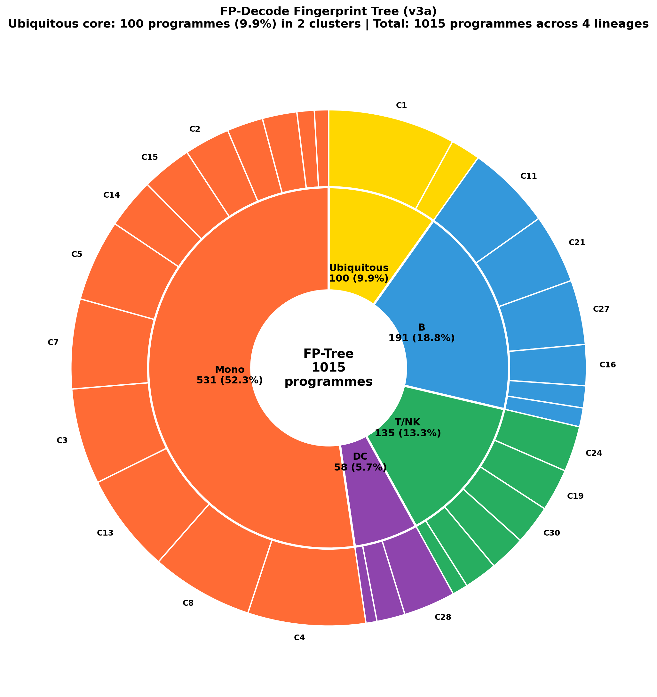
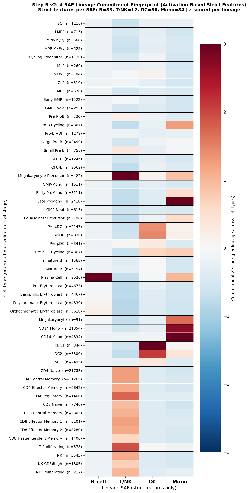

# bonemarrowmap-sae

**FP-Decode: Sparse Autoencoder-based Functional Programme Discovery and RAG-LLM Annotation in Human Haematopoiesis**

Zhuocheng (Cheng) Yu, BSDB Gurdon Summer Studentship, UCL Research Department of Structural and Molecular Biology. Supervisor: Dr Joseph Ng (Single-cell AI and Interpretability).

## What this repository does

Deep generative models such as scVI integrate single-cell atlases well, but their latent dimensions mix many biological signals and cannot be read directly. This project borrows sparse autoencoders (SAEs) from mechanistic interpretability of language models and applies them to the scVI encoder of the BoneMarrowMap human bone-marrow atlas (Zeng et al. 2025; 263,159 cells × 34,009 genes; 161,604 cells × 4,000 highly variable genes used for training). The SAE unmixes the 128-dimensional encoder activations into 2,048 sparse features; each active feature is a candidate "functional programme" (a co-regulated gene set). A retrieval-augmented LLM pipeline names each programme, external pathway databases validate the names, and the programmes are organised into a cross-lineage "FP-Tree" that is then used to test whether progenitors activate their future lineage's programmes before they show the phenotype.

```
BoneMarrowMap h5ad (161,604 × 4,000)
  → scVI encoder activations (128-dim, forward hook)
  → normalisation (centre + 95th-percentile L2 scale)        activation_norm_params.pt
  → Sparse Autoencoder 128 → 2,048, l1 = 5e-4               ae.pt, config.json
  → ANOVA feature selection (209 active features)
  → gene signatures (top-200 cells vs background, Welch t-test)
  → LLM annotation: zero-shot → RAG (MyGene.info) → few-shot → background-conditional
  → validation: manual comparison + GSEA/ORA (MSigDB Hallmark, Reactome)
  → TF-IDF clustering → FP-Tree
  → lineage-specific SAEs (T/NK, DC, monocyte) → cross-lineage FP-Tree (1,015 programmes)
  → progenitor commitment scoring along the haematopoietic hierarchy
```

## Key results

| Item | Result |
|---|---|
| SAE calibration | Default l1 = 0.1 killed 1,920/2,048 features; after activation normalisation and ablation, l1 = 5e-4 gives L0 = 53.5 and 99.6% variance explained |
| Annotation quality | Unique programme labels 107 (zero-shot) → 163 (RAG) → 170 of 209 (cluster-conditional background); plasma-cell cluster 1 → 34 of 41 |
| External validation | 10/10 top programmes confirmed by over-representation analysis against MSigDB Hallmark and Reactome, no hallucinated labels |
| Biology | Erythroid differentiation resolved into four sequential sub-programmes; plasma-cell programmes split by immunoglobulin isotype (IgK, IgL, IgG, IgA); feature #332 re-labelled from ER stress to megakaryocyte platelet assembly by RAG |
| Lineage extension | Dedicated SAEs for T/NK (610 active), DC (143 annotated, 85% unique) and monocytes (1,493 active, 442 unique); 1,015 programmes in a five-layer, 30-cluster FP-Tree with a 9.9% ubiquitous layer |
| Commitment | Lineage-fate programmes already active in progenitors (CFU-E, pre-pDC, promonocytes, Mk precursors) across all six lineages examined |

## Repository layout

```
root/            Phase 1 files uploaded in April to May 2026 (first SAE notebooks, zero-shot / RAG / few-shot
                 annotations, GSEA workbook, ae.pt and config.json of the first model); kept for provenance
code/            Phase 1 t-test series and Phase 2 scripts: task7c to task14a, Route A (task10), Route B extraction,
                 training and annotation for T/NK, DC and monocytes, cross-lineage FP-Tree, destiny programmes
notebooks/       Route B training notebooks (T/NK, DC, monocyte), FP-Tree analysis, progenitor commitment (Step A, Step B)
models/          final SAE weights and configs (full atlas l1 = 5e-4, T/NK, DC, monocyte), per-lineage normalisation
                 parameters and global cell indices, plus the config of every ablation run (ablation_configs/)
annotations/     LLM annotations per strategy: global t-test, contrastive, B-cell restricted, hybrid, Route A, Route B
signatures/      gene signatures per strategy, the MyGene.info gene-function cache (about 1,500 genes), destiny gene sets
outputs/         anova/ rankings, fp_tree/ assignments and sunburst, commitment/ matrices and heatmaps,
                 datasheets/ evaluation workbooks, figures/
```

Large intermediate matrices (activation matrices and SAE feature matrices, 30 MB to 1.4 GB each) are not tracked; the extraction and training scripts regenerate them. The two h5ad files are not tracked either; see Data below.





## Reproducing the pipeline

1. Environment: Python 3.10, PyTorch, scvi-tools, scanpy, AnnData, scikit-learn, scipy, gseapy, and the SAE library `dictionary_learning` (`pip install git+https://github.com/saprmarks/dictionary_learning.git`).
2. Data: download BoneMarrowMap (Zeng et al. 2025) and train or load a scVI model (n_top_genes = 4,000, batch_key = "Study", n_latent = 30, n_layers = 2).
3. Run `extract_scvi_activations_new.py` (root) to write the 128-dimensional activation matrices, then `20260423_Training_alternative.ipynb` (root) to normalise and train the SAE (ablate l1 before trusting any result).
4. Run the annotation scripts in order: `task7_rag_annotation.py` (root), then in `code/` `task7c_ttest_annotation.py`, `task8_bcell_restricted_ttest.py`, `task9_hybrid_ttest.py`. An `ANTHROPIC_API_KEY` is required; MyGene.info summaries are cached in `gene_function_cache.json`.
5. For lineage-specific SAEs use `code/dc_full_pipeline.py`, `code/mono_full_pipeline.py` or the T/NK trio (`extract_scvi_activations_tcnk.py`, `train_sae_tcnk.py`, `task11_tcnk_annotation.py`), then `code/task13_cross_lineage_fptree.py` and `notebooks/20260527_progenitor_commitment_analysis.ipynb`.

## Status and known limitations

Phase 1 (full-atlas SAE, annotation, validation, FP-Tree prototype) and Phase 2 (lineage-specific SAEs, cross-lineage FP-Tree, commitment analysis) are complete. Open items: within-cluster contrastive gene ranking for the early erythroid cluster and the CD8 cytotoxic features; Phase 3 to 5 of the gene-expression-space commitment scoring (`task14a_build_destiny_programs.py`, `destiny_gene_sets.json`); quantitative overlap with the atlas's 48 cNMF programmes; a fallback for MyGene.info cache misses.

## References

Zeng A. G. X. et al. (2025). Single-cell transcriptional atlas of human hematopoiesis reveals genetic and hierarchy-based determinants of aberrant AML differentiation. Blood Cancer Discovery 6:307 to 324. doi:10.1158/2643-3230.BCD-24-0342.
Hsung E. et al. (2024). InterPLM: discovering interpretable features in protein language models via sparse autoencoders.
Bricken T. et al. (2023). Towards Monosemanticity: decomposing language models with dictionary learning. Anthropic.
Lopez R. et al. (2018). Deep generative modeling for single-cell transcriptomics. Nature Methods.
Marks S. et al. dictionary_learning. https://github.com/saprmarks/dictionary_learning

## Acknowledgements

Dr Joseph Ng (UCL) for supervision and the original activation-extraction and SAE-training templates; the British Society for Developmental Biology for the Gurdon Summer Studentship.
